# Warframe Tracker

A Linux program for Warframe that answers one question fast: **which reward
should I take?**

When a Void Fissure run ends, the game gives you 15 seconds to pick one of up
to 4 rewards. Press one key and the tool reads that screen. It ranks the
options against what you already own: does the part finish a set, is it
worth ducats, can you get it another way. The answer shows in the tool's own
window and, drawn over the reward screen itself, in the game.

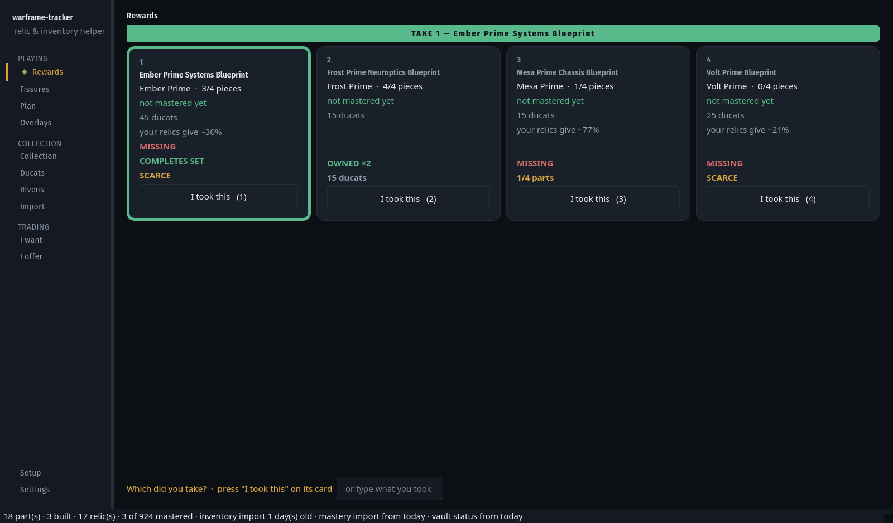

This guide is for people who are new to Linux. It starts from the archive you
received or downloaded and ends with your first reward screen and your inventory in the
tool. Every technical word is explained the first time it appears. If you get
stuck, read **How to debug** near the end, and ask whoever gave you the
tool, or the place you downloaded it from.

## What you need

- **An Arch-based Linux** (a Linux that installs programs with the command
  `pacman`). It was tested on Garuda Linux with the KDE Plasma desktop
  (version 6.7, on Wayland, the newer way Linux draws windows). Plain Arch and EndeavourOS use the same packages and
  should work. Nobody has tried them yet.
- **Warframe from Steam** (Steam runs Windows games on Linux through a part
  called Proton), with the **game language set to English**. The tool matches
  English item names.
- **The game in a window mode**, not in exclusive fullscreen. The tool reads
  the game's window, and it needs a window to find. Look for the display mode
  in the game's graphics options and choose a windowed or borderless setting.
  The exact wording in the game's menu is not recorded here. Exclusive
  fullscreen has not been tried.
- **A 16:9 game window** (for example 1920x1080 or 3840x2160). The places the
  tool reads on the reward screen were measured on 16:9. The inventory reading
  was written and tested on 4K pictures. At 1920x1080 it has only been tested
  on 4K pictures scaled down, not on real 1080p captures yet. If it reads many
  names wrong, tell whoever gave you the tool, or the place you downloaded it from.
- **An internet connection** for the first download of the game data, later
  updates of it, the fissure board, the weekly riven prices, and a few
  optional lookups (see **What the tool sends over the network**).
- **1 or 2 monitors.** See the next section.

### One monitor or two

The tool is an ordinary window. It never jumps to the front by itself,
because that would steal your keyboard in the middle of a mission.

- **With 2 monitors,** put the tool on the second one. It updates when you
  press the hotkey, and you see the answer at once.
- **With 1 monitor,** the tool's window sits behind the game. After you press
  the hotkey, you have to switch to it yourself within the 15 seconds, for
  example with Alt+Tab (the usual key to switch windows), or look at it
  after the mission. Nothing brings it forward for you. This one-monitor
  setup has not been tested yet, so treat it as unproven.

## Install

You got a file called `warframe-tracker.tar.gz`. It is an
**archive**: one file that holds many files, like a zip file.

### 1. Save and unpack the archive

1. Save the file in your `Downloads` **folder** (a folder is a place that
   holds files).
2. Open the file manager. On KDE it is called **Dolphin**.
3. Right-click the archive, choose **Extract**, then **Extract here**. A
   new folder called `warframe-tracker` appears next to it.
4. Move that folder somewhere you will keep it, for example into your home
   folder (the one Dolphin shows as **Home**, named after your user). The
   installer remembers where the folder is, so **do not move it later
   without running the installer again**.

### 2. Open a terminal in that folder

A **terminal** is a window where you type commands and press Enter to run
them. The installer is run from one, because it has to ask for your password.

1. In Dolphin, open the `warframe-tracker` folder.
2. Right-click an empty spot in the folder and choose **Open Terminal Here**.

A window opens with a line of text that waits for you. That is where you
type.

If you cannot find that menu entry, open the program **Konsole** (on KDE:
press Alt+Space, type `konsole`, press Enter) and type `cd ` followed by the
folder, for example `cd ~/warframe-tracker`, then press Enter. `cd` means
"go into this folder", and `~` stands for your home folder.

### 3. Run the installer

Type this and press Enter:

```
./install.sh
```

The installer does 4 things:

1. It installs the missing **packages**. A package is a ready-made program or
   library that Linux installs for you. This is the only step that needs
   `sudo`, which runs one command with administrator rights. It asks for your
   password. **Nothing shows while you type the password.** That is normal.
   Type it and press Enter. Then `pacman` may ask "Proceed with
   installation? [Y/n]". Press Enter.
2. If you are not in the **input group** yet, it asks **"Add (your name) to
   the input group now? [y/N]"**. Type `y` and press Enter. The **input group** is a list of users that Linux allows to
   read the keyboard directly. The tool needs it to hear your hotkey while
   Warframe has the keyboard. Being in the group means that programs you run
   can read keystrokes. The tool listens for its one key and, while the
   reward overlay is up, for left mouse clicks; it records nothing but the
   card you chose (see **What the tool sends over the network**).
3. It writes a menu entry called "Warframe Tracker" (in the "Games" group).
4. It adds two short commands, `wf` and `wf-gui`, that you can type in a
   terminal. They work after the login in the next step.

At the end it asks **"Start Warframe Tracker now? [Y/n]"**. Press Enter to
start it, or type `n` to start it later.

You can run `./install.sh` again at any time. It only does what is missing.

If you get "Permission denied", type `bash install.sh` instead.

**Double-clicking `install.sh`** also works. Choose **Launch** if Dolphin
asks. The installer opens a terminal window for itself and keeps it open
until you press Enter, so you can read what it did.

### 4. Log out and log in once

The `input` group only counts from your next login. **Log out of the
desktop and log in again once** (a restart does the same). Until you do, the
hotkey cannot hear the keyboard. The Setup page of the tool shows whether it
is active yet.

Logging out closes every program, the game included, so do it before you
play. If you started the tool at the end of the installer, you can press
**Download game data** on its Setup page first (card 1 below). Choosing the
hotkey (card 3) needs the new login.

### Start it later

On KDE: press **Alt+Space** (this opens KRunner, KDE's search box), type
`warframe tracker`, check that the highlighted entry is "Warframe Tracker"
and not the game, and press Enter. On other desktops, open the application launcher
and look under **Games** for "Warframe Tracker". Or type `wf-gui` in a
terminal.

## First start: the Setup page

The tool opens on its **Setup** page whenever a required step is still open.
The page lists what it needs, one card per step, with a status word on the
right, such as **Done**, **To do**, **Note**, **Waiting** or **Not found**. The first 3 steps are required. The
others help. Work down the page.

The **Open the guide** button at the top opens this guide as a PDF
(`GUIDE.pdf` in the program folder).

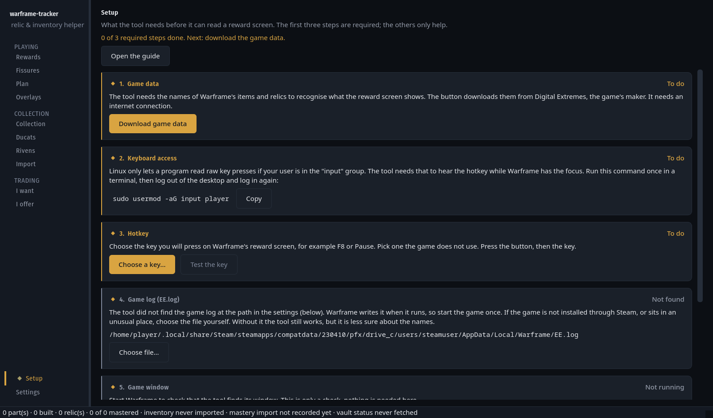

The cards turn to **Done** as you go. This page has the game data and a key,
and is waiting for the login that makes the keyboard access count:

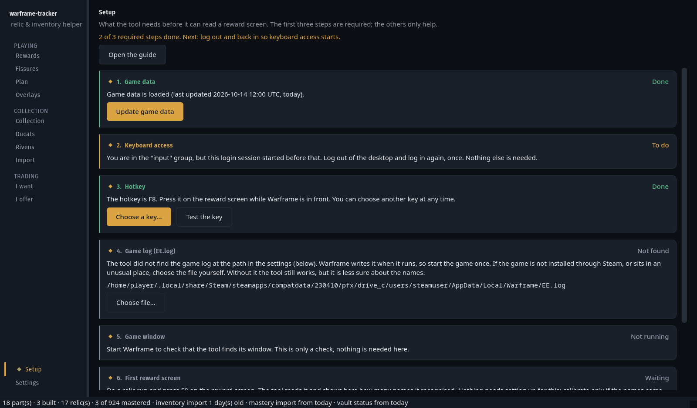

### Card 1: Game data

The tool needs the names of all items and relics to recognise a reward
screen. Press **Download game data**. It fetches them from Digital Extremes
(the makers of Warframe) and builds a local database (a file on your computer that holds the data). Watch the log under
the button until it says **Done.** Later the button reads **Update game
data**.

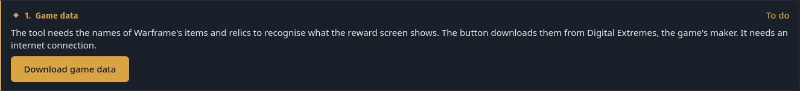

### Card 2: Keyboard access

This card shows whether the tool may read the keyboard. If you answered `y`
to the input group question and logged in again, it says **Done**.

- If it says you are in the group but the session is older, log out and in
  once.
- If it shows a command, the group is missing. Press **Copy**, open a
  terminal, paste the command (in Konsole: Ctrl+Shift+V), and press Enter. It
  asks for your password. Then log out and in once. The card shows your own
  user name in the command; the picture below shows `player`.

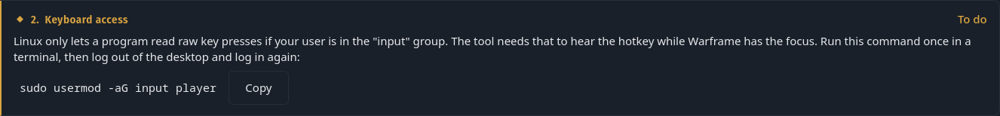

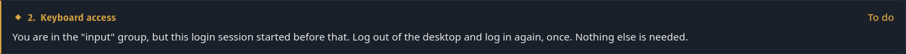

### Card 3: Hotkey

The **hotkey** is the key you press on the reward screen. Pick one that you
can reach while playing and that neither the game nor your desktop uses.
Examples: F8, Pause, Scroll Lock. If your keyboard has none of these (some
laptops), any other key you never use works too. The tool only listens to the
key. The game still receives it too.

1. Press **Choose a key…**. The card says "Press the key you want to use,
   now."
2. Press the key you want. The card shows its name, for example `F8`, and
   saves it. You do not need to know the key's technical name.
3. The card now says "Press it now to check that it arrives". Press the same
   key again. It says **Received F8. This key arrives.**

Esc cancels the choice. You can choose another key at any time, and it works
at once, without a restart. **Test the key** repeats the check later.

The check on this card works with any window in front, the tool's own
included. Reading a reward screen is different: there the key only does
something while the Warframe window has the keyboard. Pressed anywhere else,
it is ignored.

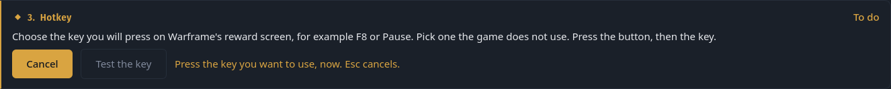

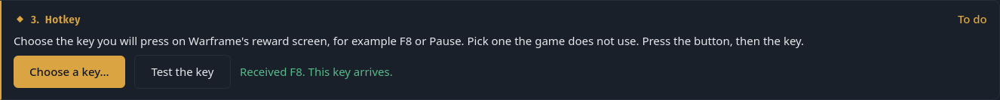

### Card 4: Game log (EE.log)

Warframe writes a log file called `EE.log` while it runs. It tells the tool
which relics your squad opened, so the tool can narrow the possible names, and
which relic you equipped yourself, so the right one is taken off your shelf.
This card is not required, but it helps.

- **Done** shows the file that was found.
- **Found elsewhere** means the file is not where the settings say, but the
  tool found it in another place where Steam keeps games: another drive, or
  the Flatpak version of Steam (Steam installed in another way). Press **Use
  this file**.
- **Not found** means it is nowhere the tool looked. Start the game once,
  because the game writes the file when it runs. If it still says **Not
  found**, choose the file yourself with **Choose file…**.

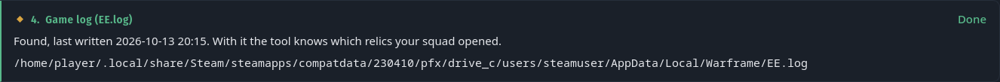

### Card 5: Game window

This card only checks that the tool can find the Warframe window. It needs the
game to be running. **Not running** is fine until you start the game. It says
**Done** and the size of the window once the game runs.

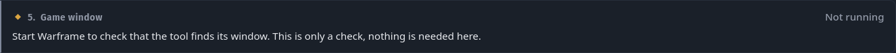

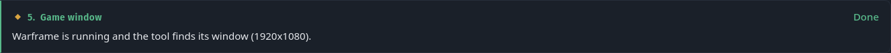

### Card 6: First reward screen

Cards 1 to 3 are all you need to read a reward screen. This card shows the
result of the last time you pressed the hotkey on a reward screen: how many
names were recognised. Until then it says **Waiting**. If the names came out
wrong, it offers a button (see **Your first reward screen**).

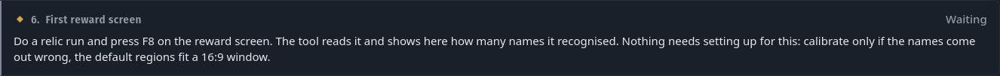

### Card 7: Your inventory

The tool ranks rewards against what you own, so it has to know your
inventory. This card shows what the last import found, and a button to the
Import page (see **Record your inventory**). Until you import, it says **Not
yet**.

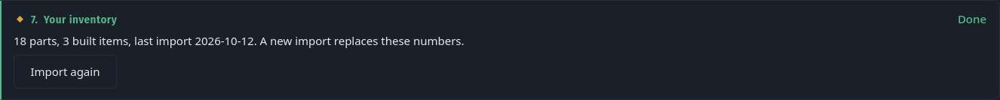

When the 3 required steps are done, the line at the top turns green and
tells you what to do next.

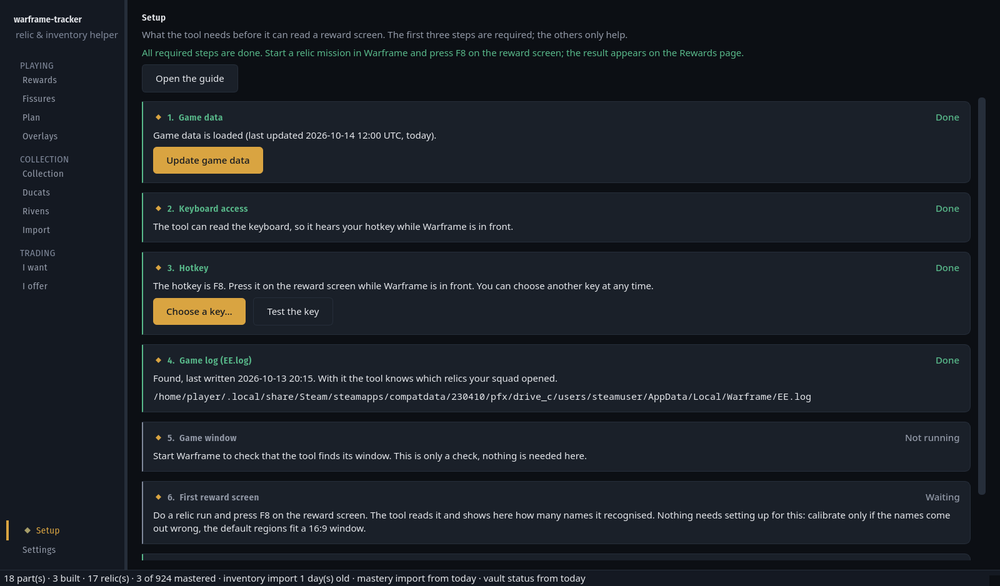

The **Rewards** page says **Not ready** until the required steps are done and
has an **Open Setup** button that takes you back here.

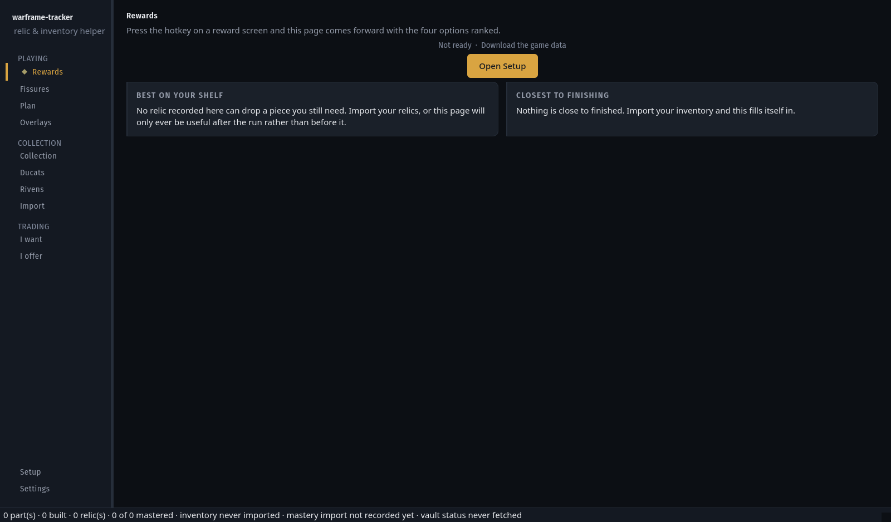

## Your first reward screen

This is a good first test of the hotkey. The ranking only becomes useful once
the tool knows what you own: until you record your inventory (next chapter),
every part looks missing to it.

1. **Keep the tool running** and start Warframe in a windowed mode. When
   the tool is ready, the Rewards page says **Ready** and names your hotkey.

    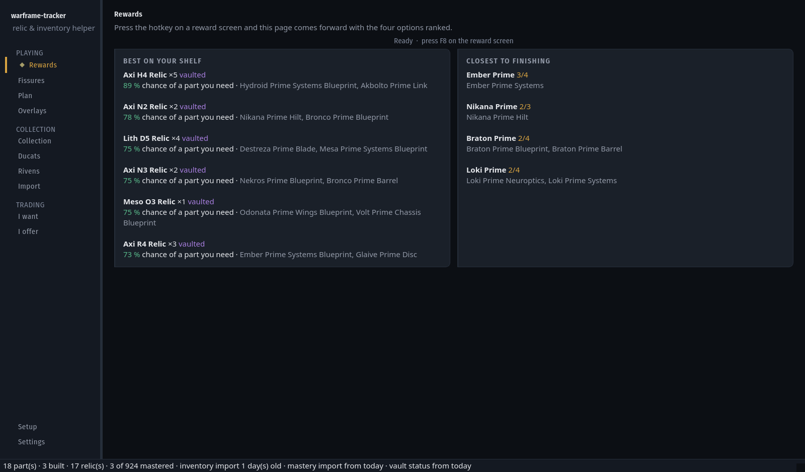

2. Play a Void Fissure mission with a relic. (The Fissures page lists the
   missions that are open right now.)
3. When the **reward screen** appears at the end of the mission, press your
   hotkey. You have about 15 seconds.
4. Look at the tool's **Rewards** page (see **One monitor or two**).

The page shows a green banner, **TAKE 1 — name** for the best option, and one
card per reward with the reasons. The words on the cards mean:

| On the card | Meaning |
| --- | --- |
| `3/4 pieces`, `3/4 parts` | You hold 3 of the 4 parts of that set. |
| `COMPLETES SET` | This part is the last one the set needs. |
| `MISSING` | You do not have this part. |
| `OWNED ×2` | You already hold 2 of this part. |
| `BUILT` | You have already built the item. |
| `not mastered yet` / `already mastered` | Whether levelling this item still gives mastery points. |
| `45 ducats` | What the part is worth at the ducat kiosk. |
| `your relics give ~30%` | The chance that opening the relics you hold gives you this part. |
| `SCARCE`, `NO OTHER SOURCE` | The part is hard or impossible to get another way, for example because its relics are vaulted (they no longer drop). |


If the banner says **RESCAN**, the tool could not read the screen. Press the
hotkey again while the reward screen is still up.

The recommendation is also drawn over the game itself (see **Reward overlay**
below). When that is switched off, or the tool cannot draw it, it appears as a
desktop notification instead (for example `TAKE 2 — Gauss Prime Blueprint`,
with the card's badges below it), so you can see it without switching
windows. While the overlay is shown, the notification is not sent. A reading that failed or found
no name shows **Could not read the reward screen** instead. To turn this off,
clear **Show the recommendation as a desktop notification** under Settings,
Capture.

On KDE this needs one setting. By default KDE holds notifications back while
a fullscreen window has focus, and the game's borderless window counts as
one. Open **System Settings** → **Notifications**, and under **Do Not Disturb
mode**, **Enable automatically**, untick **While a fullscreen application is
focused**. While that is still ticked, a note under Settings, tab Capture, and a
line in `wf doctor` point here.

### How the recommendation decides

The tool compares the options one question at a time, and the first question
that tells two options apart decides. By default the questions come in this
order:

1. Is it a piece you still need for a set you have not mastered yet? (A
   duplicate, or a piece of a set you already mastered, comes after.)
2. Is it hard to get any other way?
3. Does it finish a set?
4. How far along is its set?
5. Which item type is it? By default a Warframe comes before an Archwing, a
   companion, a Necramech and everything else.
6. Is its set smaller?
7. Do fewer relics drop it?
8. Is it a rarer drop?
9. Is it worth more ducats?

With this order, questions 2 to 8 only apply to a piece you still need, and
question 9 only to an option that adds nothing to a set (a duplicate, or a
piece of a set you already mastered). An option a question does not apply to
comes after the ones it applies to. Among options that add nothing to a set,
the ducats decide first, then a piece you do not have before a duplicate, then
the item type. Forma is always last.

If you move a question above question 1, it counts for every option: with
ducats first, the card worth the most ducats wins whether you still need it or
not, and with item type first a Warframe you already hold beats a weapon part
you need. With question 1 last, the whole list is one order.

Under **Settings**, tab **Rewards**, the card **Order of the recommendation**
lets you change this. The arrows move a question up or down (the top line
matters most). Each item type has a number, 1 first, and the same number means
the same weight. **Reset to default** brings back the order above. A change
applies to the next reward screen.

### Tell the tool what you took

Press **I took this** on the card of the reward you picked in the game (the
button also shows the card's number, for example `I took this (1)`). You
can also type the name into the field under the cards. Without leaving the game
you can instead **click the card you take** (see Reward overlay below): the
pick is recorded when the drawing goes away. The tool then adds the
part to your inventory and takes the relic you used off your shelf. If several
relics of that name were possible, it asks which one. A pick that you never
confirm leaves your inventory one short, and the page reminds you on the next
run. A pick recorded from a click shows on the page like one from the button,
with the same way to take it back.

### Only if the names come out wrong: calibrate

The tool looks for the reward names at fixed places, measured on a 16:9
window. For most people **this just works. Do not calibrate unless the names
are wrong** on a reward screen that you can read yourself.

If they are wrong, the Rewards page and Setup card 6 offer **Calibrate with
this screen**. It opens a dialog that already holds the reward screen from
your last hotkey press.

1. Drag one box around the whole first reward on the left, including its
   picture and its name (not the coloured bar below it). Use a
   screen with 4 rewards if you can. At once the dialog shows the rest of the
   row: the card you drew has a **red** frame, the other cards are pale
   **orange**, and the **green** band on your card is where the names are
   read. Under the picture, **Cards on this screen** says how many rewards
   the row has (the dialog takes it from the last reading).
2. Fit it with the keyboard. Click the picture first, then:
    - **Arrow keys** move the red card by 1 pixel, **Ctrl + arrow keys** by 10.
    - **Shift + arrow keys** change its size (Left/Right the width, Up/Down
      the height).
    - **Alt + Left/Right** change the **gap between the cards** (also a box
      under the picture, in pixels); the orange cards follow at once. The cards
      are not edge to edge.
    - **Tab** switches between the red card and the green band (or click the
      band or a card, or use **Adjusting:** under the picture). With the band
      chosen, Up/Down move it and Shift + Up/Down change its height. It has to
      cover both lines of a name that wraps.
    - **Ctrl + Tab** leaves the picture for the next control.

    Three small windows below the picture show the card's corner, the gap and
    the band's corner enlarged 4 times, so a single pixel can be seen.
    **Start from the current regions** puts the frames where the program looks
    now, to fit them from there.

3. Press **Read the names**. The dialog shows what it reads.
4. If the names are right, press **Save**.

**Your own calibration, or the measured values.** Settings, tab Capture, shows one line
under **Calibrate reward regions...**: either "Reward regions: measured
values" or "Reward regions: your own calibration in config.toml (N values)".
An earlier calibration stays in your `config.toml` and overrides the values
measured for the program, which can leave the frames a few pixels off. While
it is there, the dialog starts with a note that lists each value as yours and
as measured, and a button **Use the measured values**. It asks first, showing
the lines it removes from `config.toml`, then removes exactly those lines; the
measured values apply at once. `wf doctor` prints the same in its line
"reward regions".

The picture is kept in memory only and is gone when you close the tool. If
there is no last screen, **Capture the game window** takes one while a reward
screen is up, or **Load a screenshot...** opens a screenshot of the game
window alone. A screenshot of your whole desktop gives wrong places, and the
dialog warns you about it.

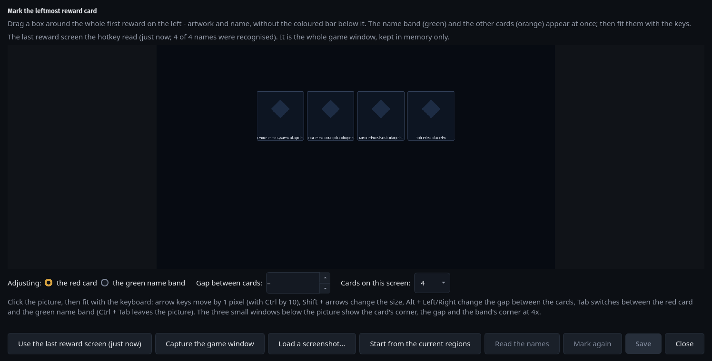

## Record your inventory

The tool reads your inventory from a recording of your screen or from
screenshots that you make yourself while you look through it in the game.
Nothing reaches your records until the last step, and every import can be
taken back.

The page also has a box **Mastery from your Warframe profile**. It finds
the items you levelled and sold long ago, which no recording can show. It is
optional. Paste your account id into the box once (the text file
`docs/SETUP.md` in the program folder shows where to find it) and the tool
asks Warframe's server for your profile by itself, at most once a day. The box
shows when it last did, what came back and when it will ask next. The first
time, it only tells you how many items reached their rank cap; press
**Review...** to look at the list and confirm. After that, new items are marked
by themselves and named in the box. The button with the circular arrow asks
right now. Please do not press it again and again: many requests in a short
time once got an address locked out of the game's login, and the box warns you
after 5 in 24 hours. If the server ever refuses, **Copy address** and **Load
saved profile...** are the way in by hand. The box also counts your beasts
(Kubrows, Kavats, Vulpaphylas, Predasites and the Helminth Charger) towards
mastery. No recording can show them: the game's inventory lists a pet under
the name you gave it, so the tool cannot read it from a picture, and the profile
is the only way they get marked.

The page also has a card **Item pictures**. The little icons in the lists come
from Warframe's own content host, one request per picture, only for things you
hold, each picture once. The tool fetches the missing ones by itself, right
after you applied an import and otherwise at most once a day, and only when
something is missing. The card shows what the last run did and when the next
automatic one may come. The button with the circular arrow fetches now; **Stop**
ends a run. If the server does not have one picture, the tool skips it; if it
refuses or cannot be reached, the run ends and the tool does not ask by itself
again for a day, not even after an import. Untick **Fetch missing pictures by themselves** to fetch only with the
button.

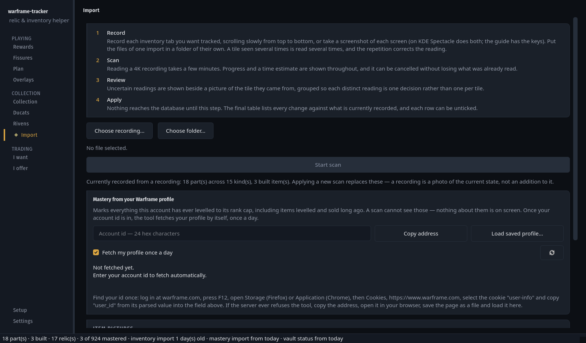

### Step 1: record it

On KDE, the program for screen recordings and screenshots is **Spectacle**.
These are its default keyboard shortcuts, unless you changed them. Meta is
the key with the Windows logo.

- **Meta+Ctrl+R** starts a recording of a window, and the same keys stop it
  ("Start/Stop Window Recording"). **Meta+Alt+R** does the same for the
  whole screen ("Start/Stop Screen Recording").
- **Meta+Print** takes a screenshot of the active window ("Capture Active
  Window"). Spectacle then shows it, and **Save** stores it. **Print** opens
  Spectacle itself.

Unless you change it in Spectacle's settings, recordings go into the folder
**Screencasts** inside **Videos**, and saved screenshots into **Screenshots**
inside **Pictures**. Their names start with `Screencast_` or `Screenshot_`,
followed by the date and time.

How to do it well:

- Switch to Warframe and open your inventory. The game has to be in front.
- Open one tab, for example Warframes. Start a recording, scroll slowly from
  the top of the tab to the bottom, and stop the recording. One recording per
  tab is the easiest way. Screenshots work too: one of each screen, scrolling
  in between.
- Do this for the tabs that matter: Warframes, Weapons, Companions, Prime
  parts, Vehicles, Archwing weapons and Relics. Leave the cosmetic tabs out.
- Pictures may overlap. A tile that appears on two pictures is counted once.
- A gap between two pictures means tiles that are never seen.
- Put the recordings or screenshots of one import into a folder of their own
  (in Dolphin: right-click, **Create New** → **Folder...**, then move the
  files there). The next step reads every picture and video in the folder
  you choose, so leave nothing else in it.

### Step 2: read them

On the Import page press **Choose folder...** and pick that folder. For a
single recording, **Choose recording...** picks one video file. Then press
**Start scan**. The scan takes some minutes. A progress bar shows how far it
is. It reads videos (`.mp4`, `.mkv`, `.webm`, `.mov`, `.avi`) and pictures
(`.png`, `.jpg`, `.jpeg`, `.bmp`, `.webp`), not folders inside the folder.

### Review

After the scan, the **review** shows one list with the questions first. Each
question shows the picture of the tile, what was read, and the names it could
be. Click the right name, or press the keys 1 to 6. Enter jumps to the next
question, **I** ignores a reading, and **M** lets you type a name; **Esc**
takes you from the name back to the list. The arrow keys move through the list
and never change an answer, and the mouse wheel scrolls the list, also over
the number field. Tiles that the scan was sure about are in the list too,
under **Accepted**. Press **Finish review** when you are done.

You can do the whole review with the right hand alone. The number pad
works like the number row: 1 to 6 pick a name, **0** ignores the reading
and moves on, **+** and **-** raise and lower the number of the open
question (or **Ctrl+Up** and **Ctrl+Down**), and its Enter works like Enter.
**Shift+Down** jumps to the next question you have not opened yet, skipping
the readings the scan was sure about; **Shift+Up** or **Shift+Enter** goes
back to the previous one. In the name field, digits, + and - are just text.
The four Requiem relics (I, II, III, IV) are easy to mix up, so when one of
them is among the names, they are always on 1, 2, 3 and 4 in that order.

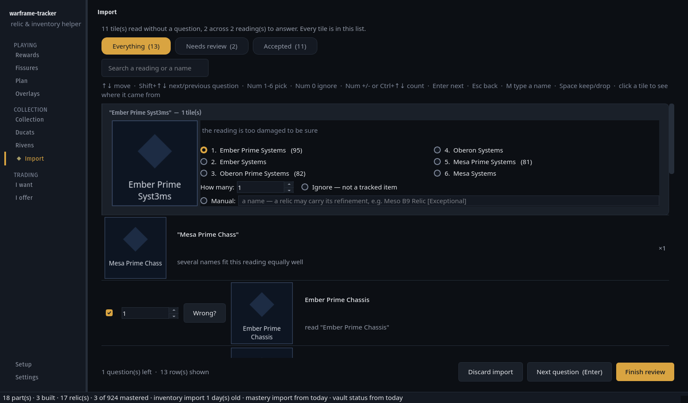

### Apply

The last step is a table of every change against what is recorded now. Each
row has a tick. You can untick a row or change a number by double-clicking
it. Rows marked "gone?" were recorded before and are missing from this
capture, whether the number came from an earlier capture, from your own hand
entry ("by hand") or from a relic pick ("picked"); only categories this capture
covers are checked, parts and built items of a category separately (a Prime Parts
recording offers missing parts, never built items). Any number of missing parts is
offered, with a note when it is many; built items are held back when too many are
missing. They are left unticked, because a tab you did not capture
looks the same as something you sold, and a part being built in the foundry is
missing from every capture. The "gone?" rows, which would write 0, and
the pieces a build used up are at the top, so you do not have to scroll to the
end to check them. **Up** and
**Down** move between rows, and **Enter** (also on the number pad) ticks or
unticks the row you are on. Press **Write to database** to apply the ticked
rows.

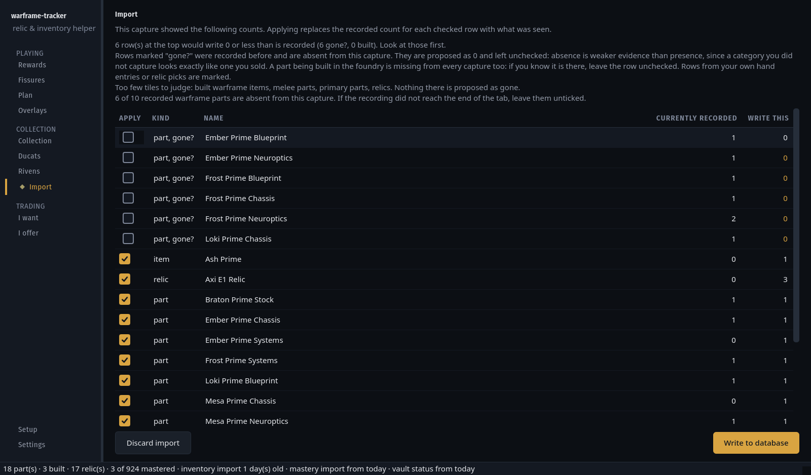

## How to use

### Every day

1. Start the tool (Alt+Space, type `warframe tracker`, Enter) and leave it
   running.
2. Play. On each reward screen, press your hotkey and read the Rewards page.
3. After you pick, press **I took this** on that card.

### What each page answers

- **Rewards.** Which reward to take. Between runs it shows the relics worth
  opening from your shelf and the sets that are closest to finished.
- **Fissures.** Which Void Fissures are open right now, by era and mission,
  with the time left, and which relic on your shelf suits each one. Under
  "Open next" the relics are sorted by **Chance**: how likely one opening gives
  you a part you still need (the same rule as Plan and Ducats, so a part of a
  finished set is not counted). **At Radiant** is that chance if you refined the
  relic to Radiant; refining raises the rare part's chance and lowers the common
  ones, so it helps only when the part you need is the rare one. Click a relic
  to see everything it drops. A mission type shown in green is a quick one, a
  short run for ten reactant (Capture and Extermination to begin with; a Void
  Storm never counts). You choose which types are quick under Settings, tab
  **Fissures**: one box per mission type and **Reset to default**. The page
  follows at once.
- **Plan.** What to do next: sets that are complete and still not built, and
  the pieces you still need, sorted so that the top of the list finishes
  something.
- **Collection.** Everything the tool knows about what you own. Every search
  and filter box in the tool forgives a typo, and the name fields suggest
  names while you type. The tab **Items** lists every item with its parts and
  where they drop. **Relics** lists every relic and which you hold.
  **Add and correct** is for hand changes: type a part, a finished item or a
  relic into the one name field (a relic as it reads on the tile, e.g.
  `Meso B9 Relic [Radiant]`) and set the total you hold; the field suggests
  names while you type, also when you misspell one, and the line under it
  says which kind it found. Only a name spelled exactly is saved. Forma, Kuva
  and the like are not counted, and the form says so. You can also
  mark an item as mastered, or save and restore a backup of your records.
  Some weapons are built into another one: two Lex Primes make an Aklex Prime.
  When you select such a weapon on the **Items** tab, there is a box **Keep one
  Lex Prime for myself, not for crafting Aklex Prime** (the same box is in the
  window that opens when you click a set on the Plan or Ducats page). Tick it
  if you want to keep one copy for yourself: the tool then treats one built copy
  as yours and not as material, so it wants one copy more and keeps the pieces
  for it. Without the tick it counts exactly what the recipe needs; once you
  have built enough copies, the remaining pieces of that weapon are offered as
  spare. The tick is saved in the backup.
- **Ducats.** What you can hand in at the ducat kiosk without costing a set a
  piece: spare parts, complete sets of items you have already mastered, and
  items you built more than once. The button **Look up
  platinum prices** asks warframe.market (a trading site) and only runs when
  you press it.
- **I want** and **I offer** (the group **Trading**). A message for the
  trading chat: the Prime sets you are missing parts of, and the Prime
  parts no set of yours needs (see below).
- **Rivens.** What rivens for a weapon sell for, from Digital Extremes' weekly
  trade numbers. The roll decides the price and the numbers cannot see the
  roll, so read them as rough figures.
- **Import.** Records your inventory (see above).
- **Overlays.** The recommendation drawn over the reward screen, and a grid
  over the game's colour palette (see below).
- **Settings.** Six tabs, like the Collection page: **Appearance** (colours,
  text size), **Game data** (the data update), **Capture** (the game window,
  the hotkey, whether the recommendation also appears as a desktop
  notification, whether the tool keeps a picture of every reward screen, see
  below), **Rewards** (status of the Rewards page, a test capture, the log
  files, the order of the recommendation), **Fissures** (which missions count
  as quick) and **Reset** (the two buttons that start over). The version line
  and **What's new** stay at the bottom on every tab.

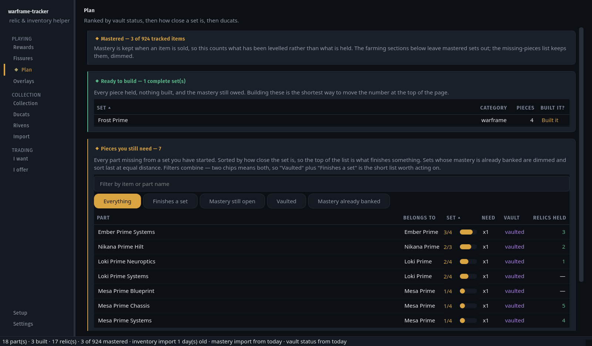

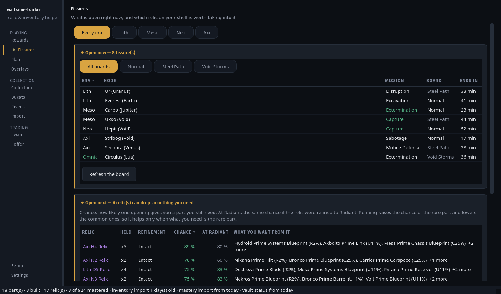

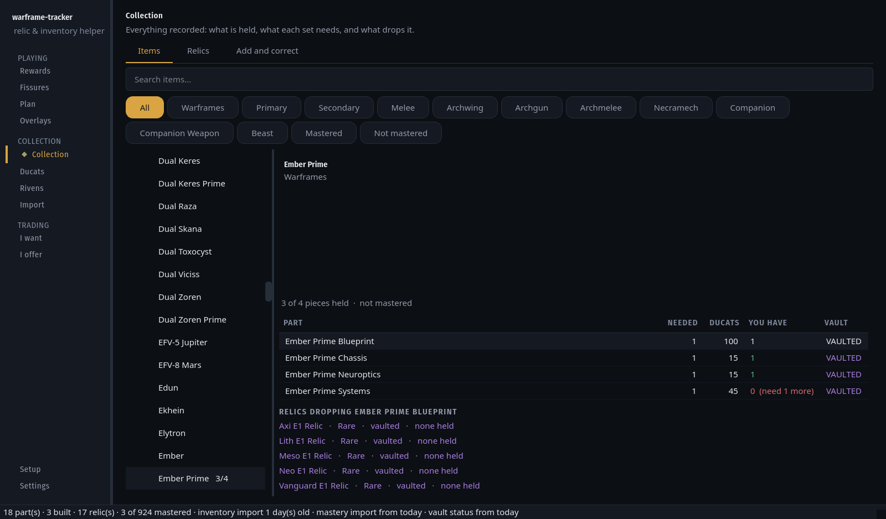

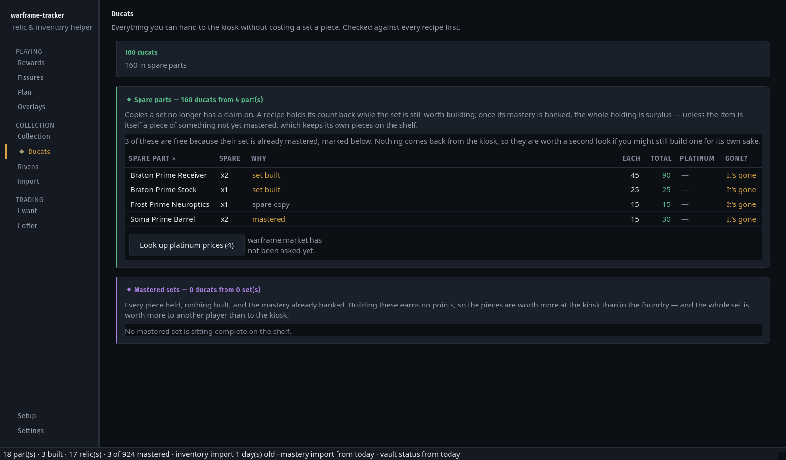

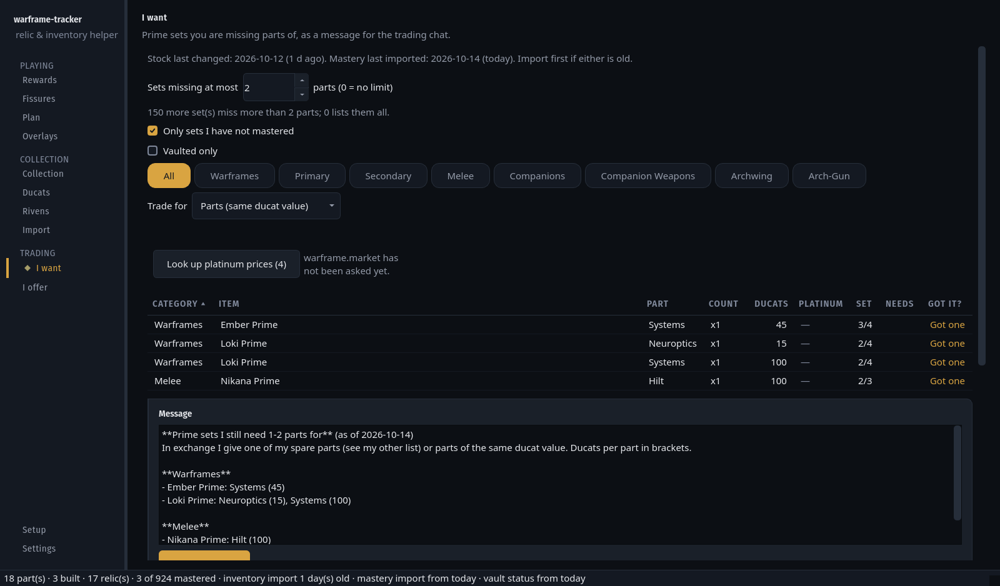

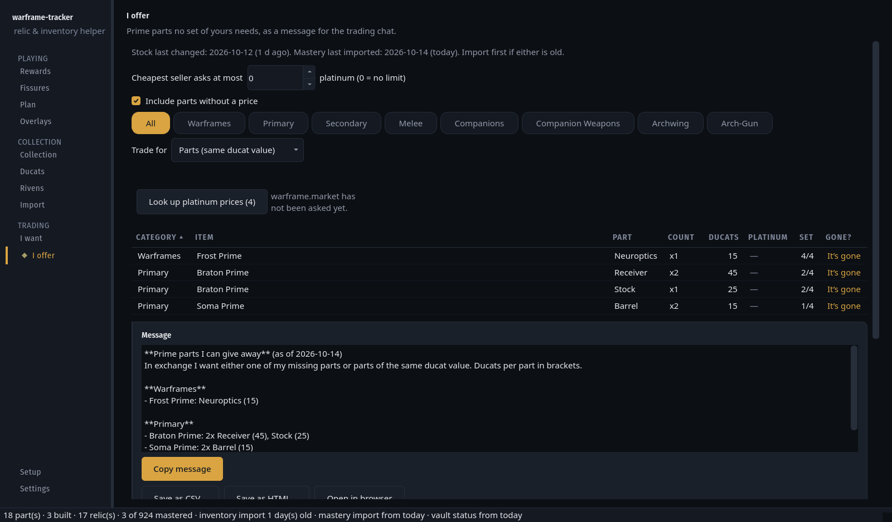

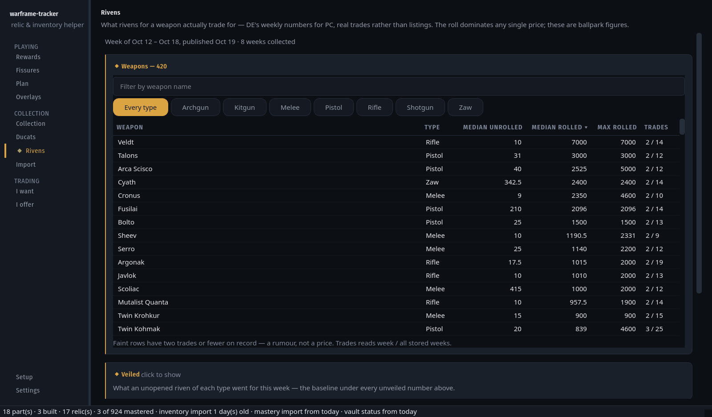

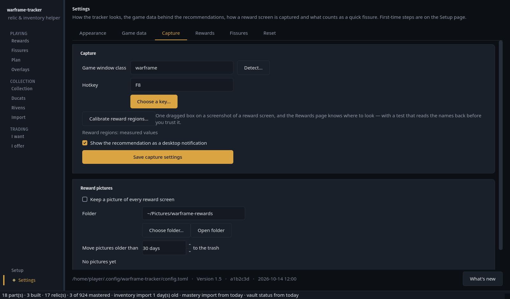

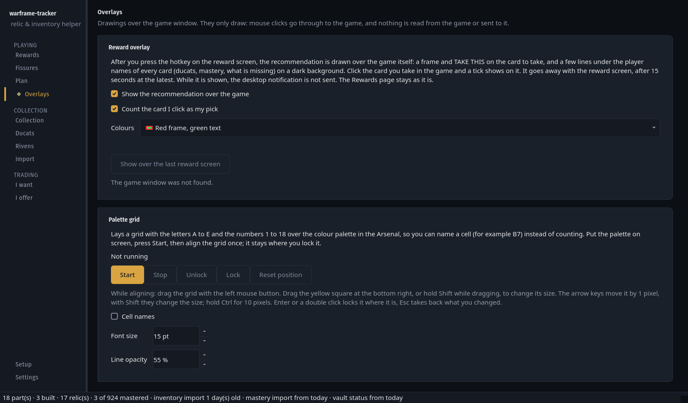

### Trading

The group **Trading** in the left column has two pages. Both build a short
message you paste into a trading chat and show
the list it says as a table. Only Prime parts are on the lists, and only
parts that can be traded: a part without a ducat value that is not itself a
built item (Galariak Prime, Sagek Prime) is on neither list.

- **I want** lists the Prime sets you are missing parts of (by default
  only a few), with the parts you need. A set that is built out of other items (Akmagnus Prime
  needs 2 Magnus Primes) appears once and says so.
- **I offer** lists the Prime parts that no set of yours still needs: spare
  copies, and everything of a set you have mastered. For a weapon that is built
  into another (Akmagnus Prime needs 2 Magnus Primes) it keeps back the pieces
  for as many copies as you still have to build, plus one if you ticked the
  keep box for it (see Collection).

Under the title, a line says when your stock last changed and when you last
imported your mastery from the profile page ("not recorded yet" until you do
that once after this update). If either is old, import first; the list is only
as good as what the tool knows.

**Filters.** On **I want**: **Sets missing at most** a number of parts (0 means
no limit: every set you are missing a part of; with a limit, a line under it
says how many more sets miss more parts), **Only sets I
have not mastered** (on), **Vaulted only**, and a row of category buttons
(All, Warframes, Primary, and so on; pick several to show all of them). On
**I offer**: **Cheapest seller asks at most** a number of platinum (0 means no
limit) and **Include parts without a price**. Without a limit, parts with no
price are on the list; with a limit, they are left out until you tick the box.
On both pages, **Trade for** decides what the message offers or asks in
return: **Parts (same ducat value)**, **Platinum** or **Parts or platinum**.
The number of parts, the limit and **Trade for** are remembered; the ticks and
category buttons are not.

**Prices.** The price column shows what the cheapest seller on warframe.market
asked the last time the tool looked, and how long ago. The tool only looks when
you press **Look up platinum prices**, as on the Ducats page; the number on the
button is how many parts it would ask about, counted before the price limit is
applied.

**The message.** Under the table, the preview shows the message exactly as it
will be copied, and it is exactly what the table shows. The title, the line
about what you trade for, and the brackets after each part are made from
**Trade for** and cannot be typed over. On **I want**, the title names the
number you set under **Sets missing at most** ("Prime sets I still need 1-3
parts for"; "Prime sets I still need parts for" with 0). With **Platinum** or **Parts or platinum**, the brackets hold the
price of the cheapest seller on warframe.market, as the tool last stored it,
and the message names the day it was checked (or the first and last day, if
the prices are from different days). A part without a stored price gets no
platinum in its brackets; a line under **Trade for** says how many parts that
is, and **Look up platinum prices** asks for them. Press **Copy message**, then
paste it into the chat. The button reads **Copied** for a moment, and beside it
the tool says how many characters it copied; it only copies text, the chat does
its own formatting.

**As a table or a page.** Under **Copy message** are three more buttons.
They all use exactly the parts the table shows, so change the filters first.

- **Save as CSV...** asks where to save (suggested name like
  `i-want-2026-10-21.csv`). Open the file in LibreOffice Calc or another
  spreadsheet program: one line per part, with the numbers as plain numbers.
- **Save as HTML...** asks where to save a web page of the list (suggested
  name like `i-offer-2026-10-21.html`). It is one file you can open in any
  browser, print, or send to someone. Printing gives dark text on white paper.
- **Open in browser** writes the same page to the `trading` folder inside the
  tool's data folder (`~/.local/share/warframe-tracker/trading/i-want.html` or
  `i-offer.html`) and opens it. The file is replaced each time. The page
  shows the full path after it opened.

After a save the page says where the file went. Neither file contains
anything beyond the list.

**Keeping the lists true.** The last column books what happened in the trade.
On **I want**, **Got one** adds 1 of that part to your stock, the same as
setting the count on the Collection page under **Add and correct**. On
**I offer**, **It’s gone** asks first and then takes 1 spare copy off your
stock. It never takes a piece a set of yours still needs. The tool does not
send or sell anything; it only keeps its own records.

### Reward overlay

After you press the hotkey on a reward screen, the tool draws its answer over
the game: a **frame** round the card to take (its inner edge is the edge of
the card, so the card itself stays uncovered) with **TAKE THIS** above it, and up
to 3 lines of text under **every** card (for example `45 ducats`,
`not mastered yet`, `MISSING · COMPLETES SET`), each card's lines on a
half-transparent dark box so they can be read on a light picture too. They are
the same words as on the Rewards page. When nothing is worth taking, the tool
writes **NOTHING WORTH TAKING** to the left of the countdown instead and
draws no frame. When the screen could not be read, it draws nothing and the
notification says so.

**Where the lines stand.** Right under the player names (up to 4 rows when all
4 players take the same card), the same for every card and for 2, 3 and 4 cards.
Where a Steel Path mission draws its own **Steel Path Bonus** box under the
middle cards, the dark box covers it: the tool's lines matter more than that
bonus text.

**Colours.** The page **Overlays**, card **Reward overlay**, has the list
**Colours**: **Red frame, green text** (the default), **Orange frame, blue text
(colour-blind safe)**, which stays clear of the red-green axis and is meant for
red-green colour blindness, one entry per app theme that reads well on a light
picture (**Theme Orokin**, and so on; the frame takes the theme's accent, the
text its green), and **Custom colours**. With the last one, the two fields
**Frame** and **Text** take a colour like `#ff2a2a`; the small square next to
each opens a colour dialog. A value that is not a colour is not saved. A text
colour that is hard to read on a light picture is saved, with a warning. The
choice is saved at once and applies the next time the overlay is drawn (**Show
over the last reward screen** shows it). The checkbox **Show the recommendation
over the game** switches the whole drawing off, and with it the colour fields.

The drawing goes away with the reward screen: every half second the tool looks
at the yellow word **REWARDS** in the screen's header, and 2 looks in a row
without it end the drawing. After 15 seconds it ends in any case. Pressing the
hotkey again replaces it.

**Which relic was yours.** When you equip a relic in the lobby, the game writes
its name into `EE.log`. The tool reads the last such line before the reward
screen and takes exactly that relic off your shelf, with no question when you
hold it at the refinement the log shows (Intact, Exceptional, Flawless,
Radiant). If there is no such line, the tool takes the relic the game loaded for
you at the start of the mission, which the log names with its refinement. If the
log does not show the refinement, or you hold the relic only at another one, the
tool asks you which of your refinements of it you used. If you refine the relic
in the relic choice of a running mission, between the rounds of an endless
mission, the log says that too: when you do not hold the relic at the
refinement it ended up at, the tool takes the one you refined it from off your
shelf without a question, and asks only if you hold neither. If the log has neither
line, the tool falls back to guessing from the relics of the screen and the
leftmost card, and asks when that leaves more than one. Taking Forma takes the
relic off your shelf and counts nothing else. This was
tried only with the game language set to English; in another language the line
reads differently and the fallback is used.

**Confirming your pick in the game.** While the drawing stands, the tool also
notes which card you click with the left mouse button in the game. A green tick
appears on that card; if you change your mind and click another card, the tick
moves, and the last card you clicked counts. When the drawing goes away, that
card is recorded as your pick, exactly as if you had pressed **I took this**,
and the Rewards page shows it with the same undo. If you did not click a card,
nothing is recorded, as before. If you already pressed **I took this** on the
page, nothing is recorded a second time. Clicks outside the cards are ignored.
A click that arrives after the tool has noticed the reward screen is gone (the
next screen) is not a pick; the log says "click: after the screen closed".
If the same reward screen is read more than once (the hotkey pressed again, or
sent by more than one of your devices) within 20 seconds, it still counts as one
pick: the screen is recorded once, and clicking or pressing **I took this**
again only moves the pick. Forma is a pick too: nothing is added to your
inventory, but the relic you opened is taken off your shelf, with the same undo.
The switch for this is **Count the card I click as my pick** below the first
one (on at the start, applies at once, grey while the overlay is off). The
button **Show over the last reward screen** shows the tick when you click, but
never records anything.

The page **Overlays**, card **Reward overlay**, has the switch **Show the
recommendation over the game** (on at the start, applies at once) and the
button **Show over the last reward screen**. The button draws the last reading
again over the game window for 5 seconds, without looking for the header, so
you can check the look and the place without playing a run. It is grey, with
the reason written under it, when no reward screen has been read yet or the
game window is not found. The overlay needs the same as the palette grid (see
below): the game as an X11 window. If it cannot be shown, the notification is
sent as before and the page shows the reason.

### Palette grid

The colour palette in the Arsenal is a table of small squares, and picking one
by counting is tedious. The page **Overlays**, card **Palette grid**, lays a
see-through grid over it: the letters A to E above the columns and the numbers
1 to 18 beside the rows, so a square has a name such as **B7** (column B, row
7).

1. Open the colour palette in the game.
2. In the tool, open **Overlays** and press **Start**. The first time, a grid
   with a yellow dashed frame appears in the middle of the screen. This is the
   aligning mode.
3. Make the grid cover the palette: drag it with the left mouse button, drag the
   yellow square at its bottom right (or hold Shift while dragging) to change
   its size. The arrow keys move it by 1 pixel, with Shift they change the
   size, and Ctrl makes the step 10 pixels.
4. Press **Enter** or double-click the grid. It is now locked: clicks go through
   it to the game, and the tool remembers where it is.

**Esc** during step 3 takes back what you changed. **Unlock** lets you align
again, **Lock** does what Enter does, **Stop** removes the grid and
**Reset position** forgets the stored place and starts the aligning again.
**Start** puts the grid back where you locked it. Under the buttons you can tick
**Cell names** to write the name into every square, and change the **Font
size** and the **Line opacity**; the grid follows at once.

The grid only draws. It reads nothing from the game and sends the game no keys
or mouse clicks, and it does not stay around when the tool is closed. It
needs the game to be an ordinary window of your desktop's X11 part (on
the tested system, Garuda with KDE Plasma on Wayland, Steam's Warframe is one).
If **Start** shows a red message instead, send it to whoever gave you
the tool, or to the place you downloaded it from, together with the output of `wf doctor`. Other desktops (GNOME,
Hyprland, Sway) and screens with a fractional scale have not been tried.

### Reward pictures

Under Settings, tab **Capture**, the card **Reward pictures** is off until you tick **Keep a
picture of every reward screen**. Then every time the hotkey reads a reward
screen, the tool saves a picture of the whole game window in the folder shown
there, one subfolder per day, named by the time, for example
`2026-10-21/14:32:19:123.jpg`. **Choose folder...** changes the folder and
**Open folder** shows it in your file manager. The Rewards page names the
picture it just saved; click the line to open the folder.

Use the pictures to look back at what was on the screen, or to check the
places the tool reads from. Each picture is about 1.3 MB at 4K, and it shows
the whole window, so the names of the people in your squad are on it. They stay
on your computer. The line under the settings tells how many pictures there
are, how much space they take and which days they cover.

**Move pictures older than ... days to the trash** cleans up for you: when the
tool starts, every day folder older than that goes to the trash, where you can
still take it back. The default is 30 days; **never** keeps them all. Only
folders named like a date are touched, nothing else in that folder.

### When to refresh

- **Game data:** once the first download is done, the tool updates it by itself
  at most once a day, so a Warframe update or a relic rotation arrives without
  you. The box **Update the reference data by itself, once a day** under
  Settings, tab Game data, turns that off; the lines under it say when the next
  check comes, what the last run did and, after a failed run, what failed and
  when the tool tries again (after a failure it waits a day). The first
  download stays the button on the Setup page, and **Update now** and **Force
  re-download** under Settings, tab Game data, work at any time. The line
  there turns amber when the data is older than 14 days; with the box on that
  only happens when the daily update keeps failing.
  Updating also refreshes which relics are vaulted.
- **Inventory:** when your holdings changed outside the tool. The tool counts
  what you confirm with **I took this**, but not what you build, sell or trade
  in the game. Record the inventory again from time to time. A new import
  replaces the old numbers of the rows you tick. For small fixes use
  **Collection**, tab **Add and correct**.

### Start over

On the Settings page, the tab **Reset** has two buttons. Each
asks once more before it deletes anything; **Cancel** is the default there.

- **Delete my inventory...** deletes your parts, items, relics and mastery,
  the import history and the dismissed readings. Your settings, the game
  data, prices and the riven history stay. Use it to record your inventory
  from scratch. First a backup goes to the trash, then the deletion, then
  the tool starts again. To get the inventory back, open **Trash** in
  Dolphin, drag the file `inventory-before-delete-….json` into your home
  folder, then use **Restore from a backup...** on the Collection page, tab
  **Add and correct**, and choose that file. That brings back the parts,
  items, mastery, relics and dismissed readings, not the import history.
- **Delete everything...** deletes all of that and also your settings
  (hotkey, reward regions, theme), the downloaded game data, the prices, the
  pages **Open in browser** wrote, and the riven history. The riven history cannot be downloaded again: the
  source only offers the current week. The files go to the trash. Your own
  recordings and screenshots stay, and so does the program. The tool then
  starts again and opens the Setup page, as on its first start.

## How to update

When whoever gave you the tool, or the place you downloaded it from, offers a new archive, its file
`PATCHNOTES.pdf` lists what changed. To install it:

1. Save the new archive in your `Downloads` folder. Leave the installed
   tool where it is. Only if `Downloads` already holds a folder called
   `warframe-tracker` (left over from unpacking), move that one to the
   trash, so the new one can be unpacked.
2. Right-click the archive, choose **Extract**, then **Extract here**.
3. Open the new `warframe-tracker` folder, right-click an empty spot and
   choose **Open Terminal Here**. Type `./install.sh` and press Enter.
4. The installer finds the installed version and asks up to three
   questions, each ending in `[Y/n]`, where Enter means yes: **It is running.
   Close it now?** (only while it runs), **Move it to the trash and put this
   version in its place?**, and **Start Warframe Tracker now?**. Press Enter
   at each. If a package or the `input` group is missing, the questions of
   the first install come too (see **Install**). The new version then sits
   where the old one was, and the copy in `Downloads` is gone. Your data and
   settings stay where they are.
5. If the game was updated, press **Update game data** on the Setup page,
   or leave it to the tool, which updates the data by itself once a day.

**Which version do I have?** The last line of the **Settings** page shows
`Version` and a number such as `1.2`, followed by a short code and a date.
In a terminal, `wf doctor` prints the same in its first line. For an archive,
the first line of its `PATCHNOTES.pdf` names the number, the code and the
date.

**What's new.** After an update, the tool opens a small window, **What's new**,
once: the changes since your version, marked `new`. Press **OK** to close it.
A fresh install shows nothing. To read it again, press **What's new** at the
end of the **Settings** page.

## How to debug

When something does not work, go through these in order.

1. **Look at the Setup page.** It shows what is missing. A card that says
   **To do** tells you what to do.
2. **Run `wf doctor`.** Open a terminal (it can be any folder) and type:

        wf doctor

    It checks the packages, the input group, the hotkey, the game log, the
    data and the game window. It changes nothing and sends nothing. Each check
    line starts with `OK`, `INFO`, `WARN` or `FAIL`. `INFO` lines are notes.
    Before the first start, `WARN` lines about the hotkey, the game data, the
    game log and the game window are normal: the Setup page deals with them.
    Fix the other `WARN` and the `FAIL` lines first.

3. **Send the whole output** of `wf doctor` to whoever gave you the
   tool, or to the place you downloaded it from. Select all of it, copy it, paste it into your message. The first
   line says which version number you have (for example `1.2`), which helps.
   Also send the **log file of the current week**. The tool writes one text
   file per week, such as `2026-W43.log`, and keeps the last 4. The `log file`
   line of `wf doctor` gives the path; or open Settings, tab **Rewards**,
   and press its **Open folder**, then attach the newest file. It holds the
   readings, the hotkey with the name of the device it came from, clicks in
   the game (without where on the screen), what was recorded, and errors. It
   holds no player names: the tool reads only the name strip of the reward
   cards.

4. **Also tell them** what you did, what you expected, and what happened
   instead. A screenshot of the tool's window helps.

If `wf` is "command not found", type `~/.local/bin/wf doctor`. The command
works after your next login.

### Common cases

- **`./install.sh` says `pacman not found`.** Your Linux is not Arch-based.
  The tool cannot be installed this way.
- **The package step fails with "404" or "failed retrieving file".** Your
  system needs an update first. On Garuda type `garuda-update` in a terminal
  and press Enter (on other Arch-based systems: `sudo pacman -Syu`). Then run
  `./install.sh` again.
- **The hotkey does nothing.**
    - Setup card 2 must say **Done**. If it says to log in again, do that.
    - Setup card 3 must show your key. Press **Test the key** and press the
      key. If it says **Received**, the key arrives.
    - The key only works while the Warframe window has the keyboard.
    - The tool must be running. The key is read inside it.
    - Settings, tab **Rewards**, has **Trigger test capture**. It does the
      same as the hotkey. If it works and the key does not, the problem is the
      key.
- **The tool starts but shows nothing useful.** Open Setup. The first card
  usually says why: the game data is not downloaded.
- **The game data download fails.** Check your internet connection and press
  the button again. The card shows the error.
- **The game is not found (card 5).** The game must run in a windowed mode.
  Under Settings, tab Capture, **Detect...** lists the open windows. The setting
  **Game window class** holds the word `warframe`. Put part of the window's
  class or title there if yours differs.
- **Names come out wrong on a reward screen.** Check that the game is in
  English, in a windowed mode, and that the interface scale in the game is
  the default. Then calibrate (see **Your first reward screen**). On a
  screen that is not a reward screen, wrong names are normal.
- **A relic you opened is not recognised.** The data is older than the relic.
  Press **Update game data** (the daily update would bring it within a day).
- **I only have one monitor and I see nothing.** The tool's window is behind
  the game. See **One monitor or two**.
- **The Import page finds nothing.** Take pictures of the inventory tabs,
  not a menu or a loading screen, with the names readable.
- **Something is wrong in my records.** Use **Collection**, tab **Add and
  correct**, or take the last import back (Import page, **What past imports
  wrote**, **Take this import back**).

**Do not change the settings file or the database by hand.** Use the
program's own pages. A wrong edit by hand is the quickest way to a problem
that is hard to find.

## Where your data lives

The program folder holds no personal data, so deleting it loses nothing of
yours. To remove the tool, see **Remove the tool**.

| What | Where |
| --- | --- |
| Your settings that differ from the defaults | `~/.config/warframe-tracker/config.toml` |
| Window size and position, the place of the palette grid, the newest version whose What's new you have seen | `~/.config/warframe-tracker/warframe-tracker.conf` |
| The database: items, your inventory, import history, prices | `~/.local/share/warframe-tracker/warframe.sqlite` |
| Downloaded game data | `~/.local/share/warframe-tracker/` |
| The page that **Open in browser** writes on the Trading pages (`i-want.html`, `i-offer.html`) | `~/.local/share/warframe-tracker/trading/` |
| The log, one file per week (`2026-W43.log`), the last 4 are kept | `~/.local/share/warframe-tracker/logs/` |
| Small images the colour theme draws | `~/.cache/warframe-tracker/glyphs/` |
| Reward pictures, only if you turned them on | the folder under Settings, tab Capture, **Reward pictures** (by default `~/Pictures/warframe-rewards`) |

`~` stands for your home folder. The folders whose names start with a dot
(`.config`, `.local`, `.cache`) are **hidden**: Dolphin does not show them
until you press Ctrl+H (or choose **Show Hidden Files** in its menu). Press
Ctrl+H again to hide them.

To back up your records, copy
`warframe.sqlite` and `config.toml`, or use **Save a backup...** on the
Collection page, tab **Add and correct**. The downloaded game data can always
be fetched again. Your inventory and import history cannot.

## What the tool sends over the network

**It never reads the game's memory and never presses a key
in the game.** It reads a picture of the game window and the game's own log
file, nothing else. The result appears in the tool's own window. The one thing
the tool draws over the game are the two pictures of the **Overlays** page, the
recommendation over the reward screen and the palette grid: see-through
pictures that let every click through. To end the reward drawing with the
reward screen, the tool looks at one small strip of the game window, the
header, twice a second while the drawing stands; that is a picture read like
the one the hotkey takes, and it stays in memory. Neither drawing sends the
game anything.

**The input group** lets the tool read key events from your keyboard, which is
how it hears the hotkey while the game has the keyboard. The tool looks for
its one key, does not record keystrokes and does not stop the key from
reaching the game. The group also lets the tool see mouse clicks. It opens
your mouse only while the reward drawing stands and the switch **Count the card
I click as my pick** is on, and closes it again when the drawing goes. Of what
it reads it keeps only left clicks made while the game window has the focus,
and for those it asks for the pointer's position to find out which card you
clicked; everything else is dropped. Nothing is stored except the card you
chose, and the click reaches the game unchanged. The log (Settings, tab
Rewards, Log) says
in a few words which card was counted or that a click was ignored (outside the
cards, game not focused), never where the pointer was. With the switch off the tool
reads no mouse events at all.

**Requests happen only in these cases:**

| When | To | For |
| --- | --- | --- |
| Setup **Download game data**, Settings **Update now**; once the data is there, also by itself at most once a day | `origin.warframe.com`, `content.warframe.com` (Digital Extremes' public data) and the drop-table page on `warframe-web-assets.nyc3.cdn.digitaloceanspaces.com` | item, recipe and relic data, and what is vaulted |
| Opening Fissures, **Refresh the board**, and by itself while that page is open | `api.warframestat.us`; if that fails or is behind the game, the game's world state at `api.warframe.com/cdn/worldState.php` and node names from `raw.githubusercontent.com` | the open fissures |
| Opening Rivens, once per program run | `www-static.warframe.com` | weekly riven trade data |
| Ducats, I want, I offer: **Look up platinum prices** | `api.warframe.market` | platinum prices, kept for 6 hours |
| Import, card **Item pictures**: by itself after an applied import and at most once a day, or the circular-arrow button | `content.warframe.com` | item icons |
| Import, card **Mastery from your Warframe profile**, only with an account id entered: by itself at most once a day, or the circular-arrow button | `api.warframe.com/cdn/getProfileViewingData.php` | which items you have ever levelled |

The tool sends no account data anywhere except your account id, and only to
Warframe's own profile address in the last row, when you have entered one. `docs/DATA-SOURCES.md` describes
each source and its terms.

## Remove the tool

In a terminal in the program folder:

```
./install.sh --uninstall
```

This removes the menu entry and the `wf` and `wf-gui` commands. It says what
it leaves: the folders of your settings and your data, the packages and your
place in the `input` group, with a command for the packages and the group in
case you want them gone too. All of that is optional. Leave the packages if
you are not sure; other programs may use them. Then move the program folder
to the trash. To remove your records too, move these three folders to the
trash: `~/.config/warframe-tracker`, `~/.local/share/warframe-tracker` and
`~/.cache/warframe-tracker`. They are hidden; **Where your data lives** says
how to see them. The riven history in them cannot be downloaded again. If you
turned on **Reward pictures**, their folder stays as well (by default
`~/Pictures/warframe-rewards`, not hidden); move it to the trash if you want
them gone.

## Licence and notice

GNU General Public License, version 3 or any later version (GPL-3.0-or-later),
see [LICENSE](../LICENSE).

The code, the tests and this guide were written by Claude (Anthropic), working
from the author's requirements, bug reports and decisions.

The reference data comes from Digital Extremes' public export files and drop
tables, and from warframe.market. [docs/DATA-SOURCES.md](DATA-SOURCES.md)
documents each with its terms. Details for installing and configuring are in
[docs/SETUP.md](SETUP.md).

Not affiliated with Digital Extremes. The pictures in this guide show game content by Digital Extremes, used under the Warframe Content Policy (<https://www.warframe.com/contentpolicy>): non-commercial and without logos. Warframe and all related content are
trademarks of Digital Extremes Ltd. This tool reads the public export files,
the game's own log file and the screen. It never reads the game's memory and
never sends input to it.
